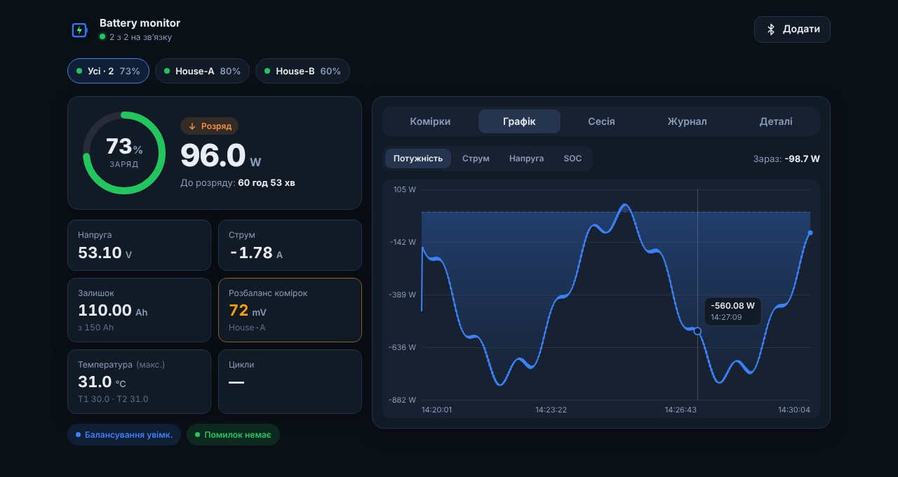
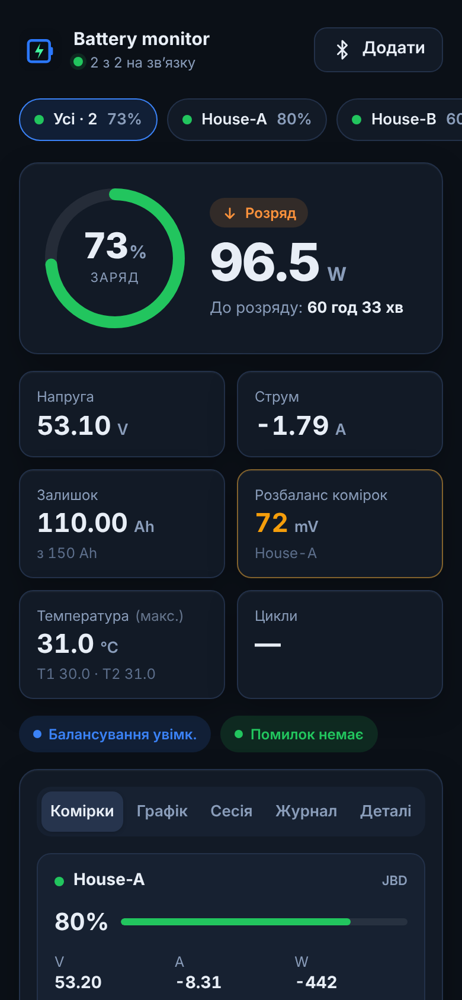
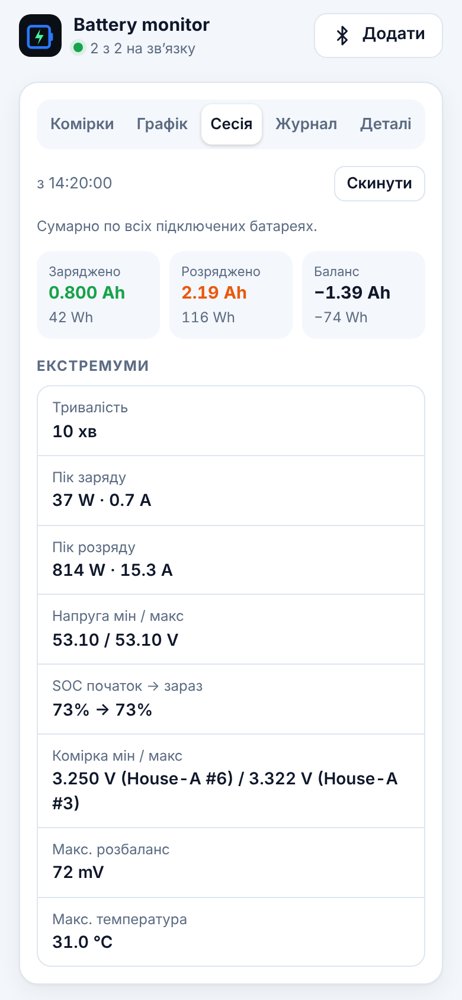
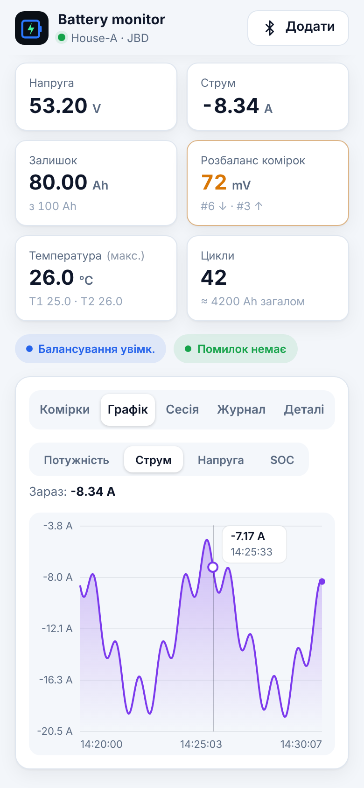
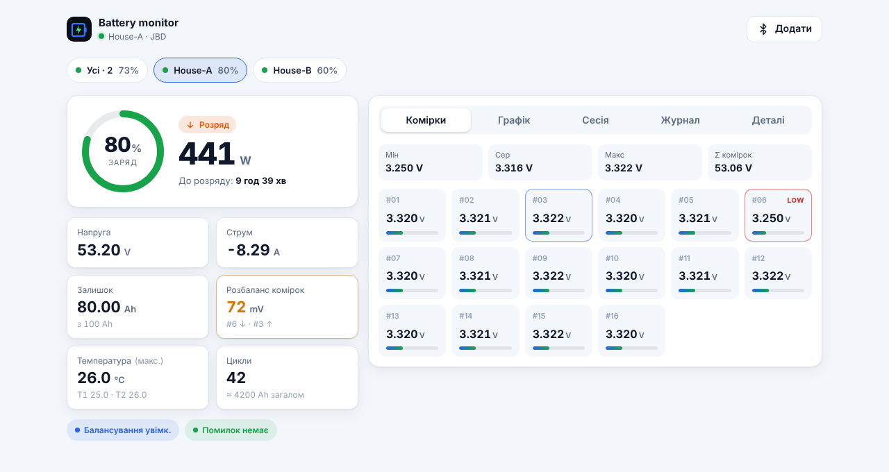
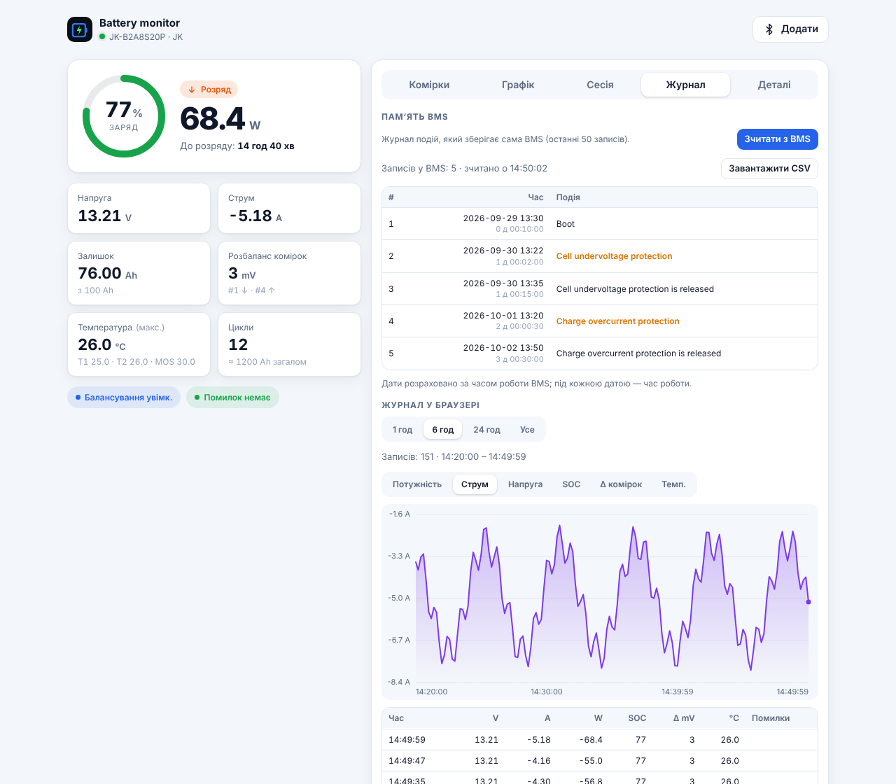

<h1 align="center">
  <br>
  web-bms
</h1>

<p align="center">
  Монітор акумулятора для BMS <b>JK</b> і <b>JBD</b> (Xiaoxiang) через <b>Web Bluetooth</b> — звичайна вебсторінка, нічого встановлювати не потрібно.
</p>

<p align="center">
  <a href="https://antondziuin.github.io/web-bms/"><b>Відкрити застосунок →</b></a>
  &nbsp;·&nbsp;
  <a href="README.md">English</a> · <b>Українська</b> · <a href="README.ru.md">Русский</a>
</p>

<p align="center">
  <a href="https://github.com/antondziuin/web-bms/actions/workflows/pages.yml"></a>
  <a href="https://github.com/antondziuin/web-bms/actions/workflows/test.yml"></a>
</p>

<p align="center">
  
</p>

## Можливості

- **Панель у реальному часі** — кільцевий індикатор SOC, потужність, заряд / розряд / очікування, час до заряду або розряду
- **Дані пакета** — напруга, струм, залишок і повна ємність, розбаланс комірок, температури (T1 / T2 / MOS), цикли, балансування, помилки BMS
- **Комірки** — напруги до 32 комірок зі зведенням мін / сер / макс, найнижча й найвища комірка підсвічені
- **Кілька батарей одночасно** — перемикач батарей і режим «Усі»: сумарна потужність і енергія (батареї різної напруги, наприклад 4S і 14S, додаються коректно), SOC і час, зважені за енергією, сумарний струм і Ah для паралельних банків, картка кожної батареї; усі підключені батареї самі підключаються під час наступного відкриття
- **Лічильники сесії** — заряджено / розряджено (Ah, Wh), баланс, піки заряду й розряду, екстремуми напруги пакета й комірок, SOC на початку і зараз, макс. температура й розбаланс
- **Графіки** — потужність, струм, напруга і SOC за останні 1000 вимірів, підказка під час наведення / дотику
- **Пам’ять BMS** — те, що зберігає сама BMS: **журнал подій JK** (увімкнення, спрацювання захистів і їх зняття, перемикання MOSFET — останні 50 записів із датами за часом роботи BMS) і **лічильники захистів JBD** (КЗ, пере-/недонапруга, перевантаження за струмом, температура); вивантаження в CSV
- **Параметри BMS** (лише перегляд) — пороги захистів зі значеннями відновлення, затримки, налаштування балансування й батареї: JK передає їх під час підключення, налаштування JBD зчитуються з пам’яті BMS на запит; нічого не записується
- **Журнал у браузері** — запис кожної батареї з обраним інтервалом (5 с – 1 хв), зберігання 7 днів на пристрої; перегляд просто на сторінці графіком і таблицею, вивантаження в CSV (Excel) або JSON, відкриття збереженого файлу; за бажанням — запис сирих кадрів BLE для діагностики
- **Робота без інтернету** (за бажанням) — застосунок пропонує зберегти себе на пристрої, потім відкривається без мережі та встановлюється на головний екран
- **Надійний зв’язок** — автоматичне перепідключення в разі обриву Bluetooth; режим «не вимикати екран»
- **Світла й темна тема**, адаптивна верстка від телефонів шириною 320 px до десктопа
- **Англійський, український і російський** інтерфейс — за мовою браузера (змінюється на вкладці «Деталі»)

## Знімки екрана

<table>
  <tr>
    <td align="center" width="33%"><br><sub>Усі батареї</sub></td>
    <td align="center" width="33%"><br><sub>Лічильники сесії</sub></td>
    <td align="center" width="33%"><br><sub>Графік струму</sub></td>
  </tr>
</table>

<table>
  <tr>
    <td align="center" width="50%"><br><sub>Одна батарея, світла тема</sub></td>
    <td align="center" width="50%"><br><sub>Журнал BMS і журнал у браузері</sub></td>
  </tr>
</table>

## Як почати

1. Відкрийте **https://antondziuin.github.io/web-bms/** у **Chrome** або **Edge** (комп’ютер чи Android).
2. Натисніть **Підключити** → **Обрати пристрій…** і виберіть BMS у системному вікні. Якщо запитають PIN, зазвичай це `123456`.
3. Щоб дивитися кілька батарей, натисніть **Додати** й виберіть наступну BMS; чип **Усі** показує їх разом.
4. Щоб користуватися застосунком без інтернету, прийміть пропозицію **Робота без інтернету** (або увімкніть пізніше: *Деталі → Налаштування*).
5. Вкладка **Журнал**: кнопка **Зчитати з BMS** показує журнал / лічильники з пам’яті BMS; нижче — журнал, який браузер веде, поки BMS підключена.

Firefox і Safari не підтримують Web Bluetooth; на iOS можна використовувати браузер [Bluefy](https://apps.apple.com/app/bluefy-web-ble-browser/id1492822055). Web Bluetooth працює лише через HTTPS або на `http://localhost`.

## Розробка

```sh
npm install
npm start          # http://localhost:8080
```

### Тести

```sh
npm test           # ESLint + юніт-тести + браузерні тести
npm run test:unit  # протоколи JK/JBD, модель, лічильники сесії, словники (node:test)
npm run test:e2e   # застосунок у headless Chromium з імітацією Bluetooth (Playwright)
```

- Браузерні тести підміняють `navigator.bluetooth` емулятором, який віддає побайтово точні кадри JBD і JK (`tests/fixtures/frames.mjs`), і перевіряють підключення, значення, кілька батарей, сесію, перепідключення, локалізацію та роботу без інтернету.
- **Тест верстки** відкриває всі екрани на ширині 320, 390, 768 і 1280 px усіма трьома мовами й падає, якщо текст вилазить за свій контейнер, обрізається або сторінка прокручується вбік.
- Перед першим запуском на своїй машині: `npx playwright install chromium`.
- Тести запускаються в GitHub Actions на кожен пул-реквест, а публікація на Pages виконується лише після їх успішного проходження.

### Знімки екрана

`npm run screenshots` перестворює `docs/screenshots/` на емуляторі Bluetooth з імітацією часу, тому зображення відтворювані.

### Структура

| Файл | Призначення |
| --- | --- |
| `index.html`, `css/styles.css` | розмітка й стилі |
| `js/protocols.js` | розбір кадрів JK / JBD (без DOM, покритий юніт-тестами) |
| `js/ble.js` | драйвери BLE поверх GATT |
| `js/model.js`, `js/session.js` | стан батареї, сума за батареями, лічильники сесії |
| `js/chart.js`, `js/i18n.js`, `js/offline.js` | графік, переклади, робота без інтернету |
| `js/bmsmemory.js` | журнал подій JK / лічильники захистів JBD з пам’яті BMS |
| `js/bmssettings.js` | параметри BMS (захисти, балансування), лише перегляд |
| `js/log.js`, `js/logformat.js`, `js/logstore.js` | журнал у браузері: запис (IndexedDB), перегляд, CSV / JSON |
| `js/app.js` | менеджер батарей та інтерфейс |
| `sw.js` | service worker (вмикається лише за згодою користувача) |
| `tests/` | юніт-, браузерні тести й тест верстки, емулятор Bluetooth, скрипт знімків екрана |

### Подяки

Команду читання журналу JK (`0xA1`), формат кадру й назви подій узято з
[syssi/esphome-jk-bms](https://github.com/syssi/esphome-jk-bms) (Apache-2.0). Лічильники захистів JBD
(регістр `0xAA`) — за опублікованим протоколом обміну JBD BMS.

### Публікація

`.github/workflows/pages.yml` запускає тести й публікує сайт на GitHub Pages під час кожного push у `main` (або вручну: *Actions → Deploy to GitHub Pages → Run workflow*). Один раз потрібно ввімкнути Pages: **Settings → Pages → Build and deployment → Source: GitHub Actions**.
